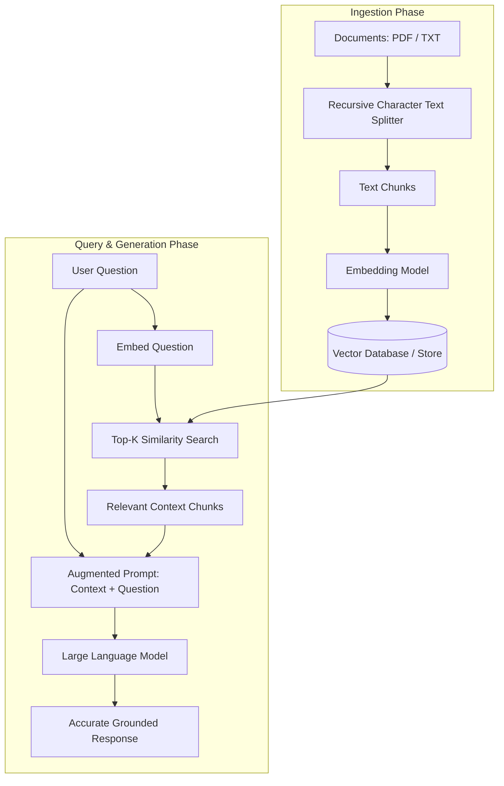

# Retrieval-Augmented Generation (RAG)

End-to-end implementations of **Retrieval-Augmented Generation (RAG)** systems combining vector search, document indexing, and Large Language Models.

---

## 📂 Directory Contents

```
RAG/
├── 1-RAG_pipeline.ipynb      # Step-by-step complete RAG architecture with vector retrieval
├── RAG_pipeline.ipynb        # Core pipeline notebook for semantic search and Q&A
├── openai_api.ipynb          # Direct OpenAI client exploration, embeddings, and chat completions
└── data/
    ├── research2.pdf         # Research paper document for PDF ingestion and vector indexing
    └── Python.txt            # Knowledge base text document on Python programming
```

---

## 🔄 RAG Architecture Overview

Retrieval-Augmented Generation grounds LLM answers in external proprietary or private documents, eliminating hallucinations:



---

## 🛠️ Key Pipeline Stages

1. **Document Loading**:
   - Ingesting heterogeneous formats (PDFs using PyPDF/PDFMiner, plain text files via standard loaders).
2. **Chunking & Text Splitting**:
   - Splitting long documents using `chunk_size` (e.g. 500-1000 characters) and `chunk_overlap` (e.g. 100-200 characters) to preserve contextual boundaries across chunk splits.
3. **Dense Vector Embeddings**:
   - Generating semantic vector representations using models such as `text-embedding-3-small` or Hugging Face sentence transformers.
4. **Vector Store & Indexing**:
   - Storing vectors in vector indices (ChromaDB, FAISS, or in-memory similarity matrices) using cosine similarity or Euclidean distance.
5. **Contextual Retrieval & Synthesis**:
   - Retrieving top-$K$ most relevant document chunks and injecting them into a structured prompt template.

---

## 🚀 Prerequisites

```bash
pip install openai langchain langchain-community pypdf faiss-cpu chromadb python-dotenv
```

Ensure `OPENAI_API_KEY` is configured in your environment or `.env` file before executing the notebooks.
