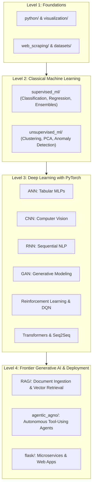

# Machine Learning, Deep Learning & Agentic AI Curriculum

A comprehensive, topic-based learning repository and hands-on portfolio organized by foundational mathematics, classical Machine Learning, modern Deep Learning architectures (PyTorch), and frontier Agentic AI.

> [!NOTE]
> This repository is dedicated exclusively to curriculum modules, conceptual notebooks, and self-contained mini-projects. Large-scale standalone projects are maintained separately outside this folder in `../Major Projects`.

---

## 🗺️ Curriculum Architecture



---

## 📚 Repository Structure Overview

```
learning/
├── python/                  # Python foundations for data science (NumPy, Pandas)
│   ├── numpy/               # Vectorized computing, broadcasting, array slicing
│   └── pandas/              # DataFrames, exploratory analysis, cleaning, aggregation
├── supervised_ml/           # Supervised Learning algorithms & mini-projects
│   ├── classification/      # Logistic Regression, KNN, Naive Bayes, SVM, Decision Trees
│   ├── regression/          # Linear, Lasso, SVR & House Price Prediction
│   └── ensemble/            # Random Forest, AdaBoost, Gradient Boosting, XGBoost, Stacking
├── unsupervised_ml/         # Unsupervised Learning & Pattern Discovery
│   ├── concepts/            # K-Means, DBSCAN, Hierarchical Clustering, PCA, Isolation Forest
│   └── mini_projects/       # SmartCart customer segmentation
├── deep_learning/           # Neural Networks & Deep Learning with PyTorch
│   ├── Neuron.ipynb         # Single neuron & perceptron mathematical foundations
│   ├── ANN/                 # Multi-Layer Perceptrons (Classification & Regression)
│   ├── CNN/                 # Convolutional Neural Networks on CIFAR-10
│   ├── RNN/                 # Recurrent Neural Networks & LSTMs for text sentiment
│   ├── GAN/                 # Vanilla GAN & DCGAN face generation on CelebA
│   ├── Reinforcement _Learning/ # Q-Learning, SARSA & Flappy Bird autonomous DQN agent
│   └── Transformer/         # T5 dialogue summarization & FastAPI serving app
├── agentic_agno/            # Frontier Agentic AI workflows with Agno (Phidata)
│   ├── agent.py             # Travel assistant agent with live DuckDuckGo web search
│   ├── finance.py           # Stock & market analysis agent with YFinance tools
│   ├── youtube_analyzer.py  # Video analysis, transcript extraction & timestamping
│   ├── memory.py            # Conversational memory retention across turns
│   └── team.py              # Multi-agent collaboration & coordination
├── RAG/                     # Retrieval-Augmented Generation with OpenAI & Vector Stores
│   ├── 1-RAG_pipeline.ipynb # End-to-end RAG architecture with vector retrieval
│   └── data/                # Ingestion knowledge base (PDF and TXT documents)
├── flask/                   # Web services & AI assistant deployments
│   └── AI_Assistant_withFlask/ # Full-stack Flask app for Q&A and email summarization
├── web_scraping/            # Data collection from web pages (BeautifulSoup, Requests)
│   ├── concepts/            # HTML parsing, CSS selectors, extraction pipelines
│   └── scraped_data/        # Raw captured HTML artifacts
├── visualization/           # Statistical data visualization (Matplotlib, Seaborn)
│   └── matplotlib/          # Figures, subplots, line charts, and styling
├── datasets/                # Centralized raw, processed, and external datasets
│   ├── raw/                 # Pristine, immutable raw source data
│   ├── processed/           # Cleaned, encoded, scaled feature sets
│   └── external/            # Benchmark reference datasets
├── utilities/               # Helper exploratory scripts and data cleaning utilities
└── resources/               # Curated documentation links, roadmaps, and cheat sheets
```

---

## 🎯 Progressive Learning Paths

### 1. Beginner Path: Foundations & Exploratory Data Analysis
1. Master array operations in [`python/numpy/`](python/numpy/README.md)
2. Master DataFrame manipulation & cleaning in [`python/pandas/`](python/pandas/README.md)
3. Learn statistical plotting in [`visualization/matplotlib/`](visualization/matplotlib/README.md)
4. Practice web data extraction in [`web_scraping/`](web_scraping/README.md)

### 2. Intermediate Path: Classical Machine Learning
1. Study classification algorithms in [`supervised_ml/classification/concepts/`](supervised_ml/classification/concepts/README.md)
2. Build real-world classification projects in [`supervised_ml/classification/mini_projects/`](supervised_ml/classification/mini_projects/README.md) (Iris, Credit Risk, Turnover)
3. Study regularized regression in [`supervised_ml/regression/`](supervised_ml/regression/README.md) and house price estimation
4. Scale up performance with [`supervised_ml/ensemble/`](supervised_ml/ensemble/README.md) (Random Forest, XGBoost)
5. Explore clustering & dimensionality reduction in [`unsupervised_ml/`](unsupervised_ml/README.md) (K-Means, DBSCAN, PCA)

### 3. Advanced Path: Deep Learning Architectures
1. Understand artificial neurons and perceptrons in [`deep_learning/Neuron.ipynb`](deep_learning/Neuron.ipynb)
2. Train PyTorch MLPs in [`deep_learning/ANN/`](deep_learning/ANN/README.md)
3. Build computer vision classifiers in [`deep_learning/CNN/`](deep_learning/CNN/README.md)
4. Model text and sequences with LSTMs in [`deep_learning/RNN/`](deep_learning/RNN/README.md)
5. Experiment with generative modeling in [`deep_learning/GAN/`](deep_learning/GAN/README.md)
6. Train autonomous game agents in [`deep_learning/Reinforcement _Learning/`](deep_learning/Reinforcement%20_Learning/README.md)
7. Fine-tune sequence-to-sequence Transformers and deploy them via FastAPI in [`deep_learning/Transformer/`](deep_learning/Transformer/README.md)

### 4. Frontier Path: Generative AI, RAG & Autonomous Agents
1. Ingest proprietary documents and perform semantic retrieval in [`RAG/`](RAG/README.md)
2. Build tool-calling agents and multi-agent teams in [`agentic_agno/`](agentic_agno/README.md)
3. Deploy interactive web apps and AI assistants in [`flask/`](flask/README.md)

---

## 📂 Detailed Folder & Module Guide

| Section | Key Topics & Models | Documentation Link |
| :--- | :--- | :--- |
| **Python** | NumPy arrays, broadcasting, vectorization, Pandas DataFrames, cleaning, EDA | [`python/README.md`](python/README.md) |
| **Supervised ML** | Logistic Regression, KNN, Naive Bayes, SVM, Decision Trees, SVR, Lasso | [`supervised_ml/README.md`](supervised_ml/README.md) |
| **Ensembles** | Random Forest, AdaBoost, Gradient Boosting, XGBoost, Stacking | [`supervised_ml/ensemble/README.md`](supervised_ml/ensemble/README.md) |
| **Unsupervised ML**| K-Means, DBSCAN, Hierarchical Clustering, PCA, Isolation Forest | [`unsupervised_ml/README.md`](unsupervised_ml/README.md) |
| **Deep Learning** | PyTorch ANN, CNN (CIFAR-10), RNN/LSTM (IMDB), GAN (CelebA), RL (DQN) | [`deep_learning/README.md`](deep_learning/README.md) |
| **Transformers** | Hugging Face T5 fine-tuning on SAMSum dialogue dataset & FastAPI serving | [`deep_learning/Transformer/README.md`](deep_learning/Transformer/README.md) |
| **Agentic AI** | Agno agent framework, Groq, tool integrations (DuckDuckGo, YFinance, YouTube) | [`agentic_agno/README.md`](agentic_agno/README.md) |
| **RAG** | Vector embeddings, document chunking, similarity retrieval, augmented generation | [`RAG/README.md`](RAG/README.md) |
| **Flask** | AI personal assistant web app, streaming completions, email summarizer | [`flask/README.md`](flask/README.md) |
| **Web Scraping** | BeautifulSoup, Requests, HTML parsing, tabular extraction | [`web_scraping/README.md`](web_scraping/README.md) |
| **Visualization**| Matplotlib figure anatomy, custom subplots, histograms, correlation heatmaps | [`visualization/README.md`](visualization/README.md) |
| **Datasets** | Raw, processed, and external dataset governance | [`datasets/README.md`](datasets/README.md) |
| **Resources** | Curated cheat sheets, official documentation links, and book references | [`resources/README.md`](resources/README.md) |

---

## 🚀 Quick Start & Environment Setup

### 1. Requirements
Install the unified dependencies across the curriculum:
```bash
pip install numpy pandas scikit-learn matplotlib seaborn torch torchvision transformers agno openai requests beautifulsoup4 fastapi uvicorn flask
```

### 2. Environment Variables
For modules interacting with LLMs and external APIs (`agentic_agno/`, `RAG/`, `flask/`), configure your `.env` file in the workspace:
```env
OPENAI_API_KEY=your_openai_api_key_here
GROQ_API_KEY=your_groq_api_key_here
```

### 3. Running Notebooks & Applications
- **Notebooks**: Launch JupyterLab (`jupyter lab`) or open `.ipynb` files in your IDE.
- **FastAPI Transformer App**: `cd "deep_learning/Transformer/Mini_Proj_Text_Summarizer" && uvicorn app:app --reload`
- **Flask Assistant**: `cd "flask/AI_Assistant_withFlask" && python main.py`
- **Agno Agents**: `cd "agentic_agno" && python agent.py`

---

**Last updated**: 2026-10-25
