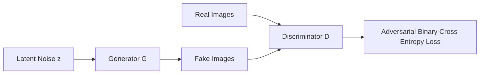

# Generative Adversarial Networks (GAN)

Implementation of generative models based on the adversarial framework introduced by Ian Goodfellow et al., implemented in **PyTorch**.

---

## 📂 Directory Contents

| File / Folder | Description | Key Focus |
| :--- | :--- | :--- |
| `vanilla_gan.ipynb` | Standard fully connected Generative Adversarial Network | Latent vector $z \sim \mathcal{N}(0, 1)$, Generator & Discriminator MLPs |
| `dcgan.ipynb` | Deep Convolutional Generative Adversarial Network (DCGAN) | Transposed convolutions (`ConvTranspose2d`), facial image synthesis on CelebA |
| `img_align_celeba/` | Directory housing aligned face samples from the CelebFaces Attributes dataset | Training images |
| `prac.ipynb` | Experimentation scratchpad for adversarial losses and gradient monitoring | Practice & debugging |

---

## 🎭 The Adversarial Minimax Game

A GAN consists of two competing neural networks trained simultaneously:

$$\min_G \max_D V(D, G) = \mathbb{E}_{x \sim p_{\text{data}}(x)}[\log D(x)] + \mathbb{E}_{z \sim p_z(z)}[\log (1 - D(G(z)))]$$

- **Discriminator ($D$)**: Learns to distinguish between real images and synthetic images produced by $G$.
- **Generator ($G$)**: Learns to generate realistic images from a random latent distribution $z$ to fool the discriminator.

---

## 🚀 DCGAN Guidelines & Techniques

The `dcgan.ipynb` notebook implements the foundational architecture proposed by Radford et al.:
1. **Replace Pooling**:
   - Generator: Fractional-strided convolutions (`nn.ConvTranspose2d`) for upsampling.
   - Discriminator: Strided convolutions (`nn.Conv2d`) for downsampling.
2. **Batch Normalization**:
   - Stabilizes learning by normalizing inputs to each unit, preventing mode collapse.
3. **Activation Functions**:
   - Generator: `ReLU` in all hidden layers, `Tanh` for the final output layer to constrain pixel values to $[-1, 1]$.
   - Discriminator: `LeakyReLU` (slope $\alpha = 0.2$) in all layers to allow gradient flow even when units are inactive.
4. **Weight Initialization**:
   - Initialized with zero-mean normal distribution and standard deviation $\sigma = 0.02$.

---

## 💡 Training Stability Tips

- **Normalize Inputs**: Scale training images to range $[-1, 1]$ to match the generator's `Tanh` output.
- **Separate Optimizers**: Maintain two distinct `optim.Adam` instances (standard setup: $\text{lr} = 0.0002$, $\beta_1 = 0.5$, $\beta_2 = 0.999$).
- **Fixed Noise Vector**: Keep a static batch of latent noise vectors `fixed_noise = torch.randn(64, latent_dim, 1, 1, device=device)` to monitor visual generation progress across epochs.
