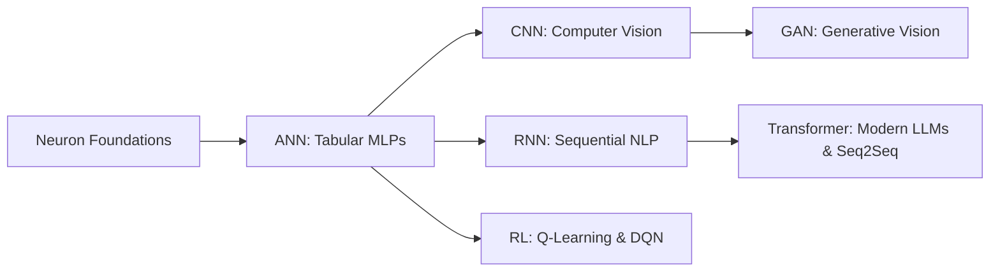

# Deep Learning

A comprehensive curriculum and hands-on repository covering foundational and modern Deep Learning architectures using **PyTorch** and **Hugging Face**.

---

## 📂 Directory Structure

```
deep_learning/
├── Neuron.ipynb                     # Perceptron & single artificial neuron from scratch
├── prac.ipynb                       # General deep learning experimentation notebook
├── ANN/                             # Artificial Neural Networks (MLP)
│   ├── ANN_Classification.ipynb    # Multi-class classification (Date Fruit dataset)
│   ├── ANN_Regression.ipynb        # Continuous value prediction (Combined Cycle Power Plant)
│   └── DateFruit_Dataset.csv / powerplant_data.csv
├── CNN/                             # Convolutional Neural Networks
│   └── CNN_for_CIFAR10.ipynb        # Image classification on CIFAR-10 (Convolutions, Pooling)
├── RNN/                             # Recurrent Neural Networks & LSTMs
│   └── RNN_for_sentimentanalysis.ipynb # Text sentiment analysis (IMDB 50k dataset)
├── GAN/                             # Generative Adversarial Networks
│   ├── vanilla_gan.ipynb           # Standard generator-discriminator game
│   └── dcgan.ipynb                 # Deep Convolutional GAN trained on CelebA faces
├── Reinforcement _Learning/         # RL Algorithms & Autonomous Game Agent
│   ├── Q_Learning.ipynb            # Tabular Q-Learning fundamentals
│   ├── SARSA.ipynb                 # On-policy SARSA algorithm
│   └── Flappy_Bird_Game/           # Deep Q-Network (DQN) playing Flappy Bird
└── Transformer/                     # Modern Attention Mechanisms & NLP
    ├── text_summarizer.ipynb       # Fine-tuning T5 on SAMSum dialogue dataset
    └── Mini_Proj_Text_Summarizer/  # FastAPI deployment for real-time dialogue summarization
```

---

## 🎯 Architectural Domains Covered

| Domain | Architecture | Primary Notebook / Project | Key Concepts |
| :--- | :--- | :--- | :--- |
| **Foundations** | Single Neuron / Perceptron | `Neuron.ipynb` | Weights, bias, activation functions, forward pass, gradient descent |
| **Tabular & Dense** | Artificial Neural Network (ANN / MLP) | `ANN/` | Multi-layer perceptron, PyTorch `nn.Module`, CrossEntropy, MSELoss, Adam |
| **Computer Vision** | Convolutional Neural Network (CNN) | `CNN/` | Filters, stride, padding, feature maps, MaxPooling, CIFAR-10 classification |
| **Sequential & Text** | Recurrent Neural Network (RNN / LSTM) | `RNN/` | Hidden states, vanishing gradients, text tokenization, embeddings, IMDB sentiment |
| **Generative Modeling** | Generative Adversarial Networks (GAN) | `GAN/` | Generator vs. Discriminator minimax game, latent vectors, DCGAN, CelebA |
| **Decision & Control**| Reinforcement Learning (RL) | `Reinforcement _Learning/` | Markov Decision Processes, Q-learning, SARSA, DQN, Experience Replay |
| **Attention & Transformers** | Transformer / Seq2Seq | `Transformer/` | Self-attention, T5 model, Hugging Face, fine-tuning, FastAPI deployment |

---

## 🚀 Recommended Learning Path



1. **Neuron Foundations (`Neuron.ipynb`)**:
   - Understand linear combinations ($z = Wx + b$) and non-linear activations (Sigmoid, ReLU, Tanh).
2. **Artificial Neural Networks (`ANN/`)**:
   - Master PyTorch custom datasets, DataLoader, training loops, forward/backward passes, and checkpoint saving (`best_model.pt`).
3. **Convolutional Neural Networks (`CNN/`)**:
   - Learn how 2D convolutions extract spatial hierarchies for visual recognition on CIFAR-10.
4. **Recurrent Networks (`RNN/`)**:
   - Model sequential dependencies and text tokenization for sentiment classification.
5. **Generative Modeling (`GAN/`)**:
   - Understand adversarial training dynamics, discriminator loss, and generator trickery.
6. **Reinforcement Learning (`Reinforcement _Learning/`)**:
   - Transition from tabular methods (Q-Learning, SARSA) to Deep Q-Networks (DQN).
7. **Transformers (`Transformer/`)**:
   - Explore state-of-the-art encoder-decoder models (T5) and deploy them via FastAPI.

---

## ⚙️ Core PyTorch Workflow Pattern

All notebooks in this directory follow the standard PyTorch training and evaluation blueprint:

```python
import torch
import torch.nn as nn
import torch.optim as optim
from torch.utils.data import DataLoader, TensorDataset

# 1. Device configuration
device = torch.device("cuda" if torch.cuda.is_available() else "mps" if torch.backends.mps.is_available() else "cpu")

# 2. Define Architecture
class Model(nn.Module):
    def __init__(self, input_dim, hidden_dim, output_dim):
        super().__init__()
        self.net = nn.Sequential(
            nn.Linear(input_dim, hidden_dim),
            nn.ReLU(),
            nn.Dropout(0.2),
            nn.Linear(hidden_dim, output_dim)
        )
    def forward(self, x):
        return self.net(x)

# 3. Instantiate, Loss & Optimizer
model = Model(input_dim=10, hidden_dim=64, output_dim=1).to(device)
criterion = nn.MSELoss()
optimizer = optim.Adam(model.parameters(), lr=0.001)

# 4. Training Loop
for epoch in range(epochs):
    model.train()
    for batch_x, batch_y in dataloader:
        batch_x, batch_y = batch_x.to(device), batch_y.to(device)
        optimizer.zero_grad()
        predictions = model(batch_x)
        loss = criterion(predictions, batch_y)
        loss.backward()
        optimizer.step()
```

---

## 📦 Prerequisites & Key Libraries

- **Deep Learning**: `torch`, `torchvision`, `torchaudio`
- **Transformers & NLP**: `transformers`, `datasets`, `evaluate`, `tokenizers`, `nltk`
- **RL & Simulation**: `gymnasium`, `flappy-bird-gymnasium`
- **Serving & UI**: `fastapi`, `uvicorn`, `jinja2`
- **Data & Math**: `numpy`, `pandas`, `scikit-learn`, `matplotlib`, `seaborn`

---

**Happy Deep Learning! Explore each subfolder for detailed implementations, datasets, and guides.**
