# Recurrent Neural Networks (RNN & LSTM)

Modeling sequential data and Natural Language Processing (NLP) using Recurrent Neural Networks in **PyTorch**.

---

## 📂 Directory Contents

| File | Description |
| :--- | :--- |
| `RNN_for_sentimentanalysis.ipynb` | Text sentiment classification model built and trained on the IMDB 50,000 movie reviews dataset |
| `IMDB Dataset.csv` | Full dataset containing 50,000 labeled movie reviews (`review` text and `sentiment` binary target: positive/negative) |
| `prac.ipynb` | Scratchpad for sequence padding, embedding layer experiments, and hidden state inspection |

---

## 📜 NLP & Sequential Pipeline

```mermaid
flowchart LR
    A["Raw Text Review"] --> B["Text Cleaning & Tokenization"]
    B["Text Cleaning & Tokenization"] --> C["Vocabulary & Integer Encoding"]
    C["Vocabulary & Integer Encoding"] --> D["Sequence Padding / Truncation"]
    D["Sequence Padding / Truncation"] --> E["Embedding Layer (nn.Embedding)"]
    E["Embedding Layer (nn.Embedding)"] --> F["RNN / LSTM Layer"]
    F["RNN / LSTM Layer"] --> G["Dense Head & Sigmoid"]
    G["Dense Head & Sigmoid"] --> H["Sentiment Probability"]
```



### Key Stages Explained:
1. **Preprocessing & Tokenization**:
   - Lowercasing, removing HTML tags/punctuation, and splitting reviews into token sequences.
2. **Vocabulary Building**:
   - Building a mapping from top $N$ unique words to token IDs, reserving index 0 for `<PAD>` and index 1 for `<UNK>`.
3. **Embedding Layer (`nn.Embedding`)**:
   - Mapping high-dimensional sparse token indices into dense semantic vectors:
     $$\text{Embedding}: \mathbb{R}^{B \times L} \to \mathbb{R}^{B \times L \times D}$$
4. **Recurrent / LSTM Units**:
   - Passing sequentially through time steps $t=1 \dots T$, updating hidden state $h_t$:
     $$h_t = \tanh(W_{ih} x_t + b_{ih} + W_{hh} h_{t-1} + b_{hh})$$
   - Handling long-term dependencies and mitigating vanishing gradients through gating mechanisms in **LSTM** (input, forget, output gates, cell state $C_t$).
5. **Classification Head**:
   - Extracting the final hidden state $h_T$ or applying pooling across time steps into a fully connected layer with `nn.BCEWithLogitsLoss`.

---

## 🛠️ Code Blueprint

```python
import torch
import torch.nn as nn

class SentimentLSTM(nn.Module):
    def __init__(self, vocab_size, embed_dim, hidden_dim, output_dim, n_layers=2, dropout=0.3):
        super().__init__()
        self.embedding = nn.Embedding(vocab_size, embed_dim, padding_idx=0)
        self.lstm = nn.LSTM(
            embed_dim, 
            hidden_dim, 
            num_layers=n_layers, 
            batch_first=True, 
            dropout=dropout if n_layers > 1 else 0,
            bidirectional=True
        )
        self.fc = nn.Linear(hidden_dim * 2, output_dim)
        self.dropout = nn.Dropout(dropout)
        
    def forward(self, text):
        embedded = self.dropout(self.embedding(text))
        output, (hidden, cell) = self.lstm(embedded)
        # Concatenate final forward and backward hidden states
        hidden_cat = torch.cat((hidden[-2, :, :], hidden[-1, :, :]), dim=1)
        return self.fc(self.dropout(hidden_cat))
```

---

## 💡 Practical Insights

- **`batch_first=True`**: Ensures input tensor shape is `[batch_size, seq_len, embed_dim]`.
- **Bidirectional LSTMs**: Process sequences in both forward and backward directions, capturing surrounding context effectively.
- **Handling Variable Lengths**: Using `torch.nn.utils.rnn.pad_sequence` or packed sequences for memory and computation efficiency.
