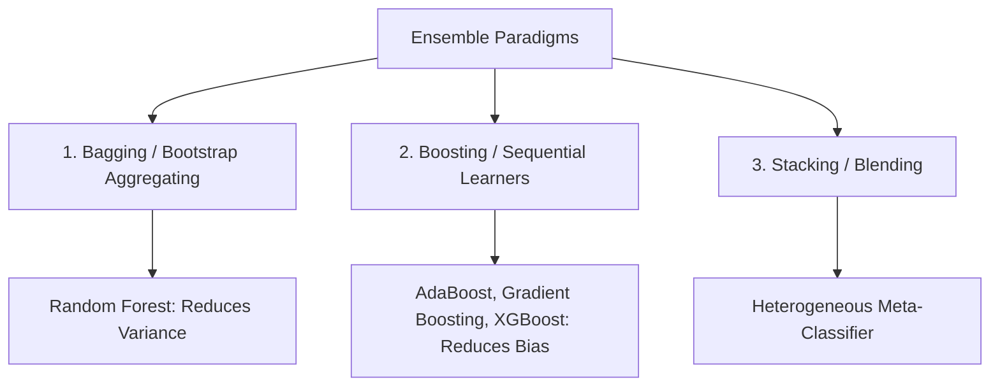

# Ensemble Learning

Combining multiple base estimators to create a superior, robust predictive model with reduced variance and bias.

---

## 📂 Subdirectories

| Directory | Description |
| :--- | :--- |
| [`concepts/`](concepts/README.md) | Notebooks covering Random Forest, AdaBoost, Gradient Boosting, XGBoost, and Stacking |
| `mini_projects/` | Planned portfolio projects utilizing ensemble methods |

---

## 🧭 The Three Pillars of Ensembles

1. **Bagging (Bootstrap Aggregation)**:
   - Trains identical base models independently in parallel on random bootstrap samples.
   - Example: **Random Forest** (adds random feature subspace sampling to reduce correlation between individual trees).
   - Primary Goal: **Reduce Variance (Overfitting)**.
2. **Boosting**:
   - Trains weak learners sequentially, with each subsequent model paying increased attention to errors made by previous models.
   - Examples: **AdaBoost**, **Gradient Boosting (GBM)**, **XGBoost**.
   - Primary Goal: **Reduce Bias**.
3. **Stacking / Heterogeneous Ensembles**:
   - Trains diverse model families (e.g., Logistic Regression + KNN + SVM) and uses a meta-model to learn how to combine their predictions.
